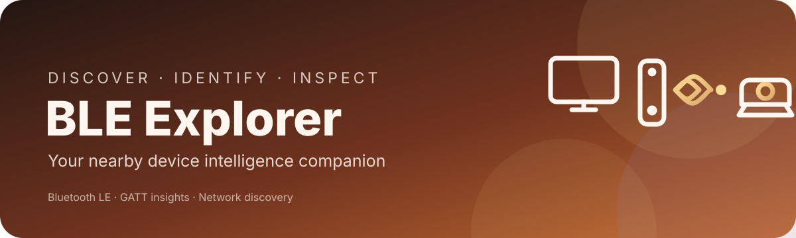

  

<h1 align="center">BLE Explorer</h1>

Discover nearby Bluetooth devices. Understand what they are. Inspect supported BLE services and authorized local-network devices.

  <a href="https://github.com/rath0darya/BLE/releases">Latest APK</a> ·
  <a href="https://github.com/rath0darya/BLE/actions">Builds</a> ·
  <a href="docs/index.html">Project site</a> ·
  <a href="docs/about.html">About</a>

## Features

- Bluetooth LE discovery with signal history, device categories and pairing state.
- Category visuals for TVs, remotes, EVs, cameras, audio, phones and more.
- Supported BLE GATT service and characteristic inspection.
- Nearby Wi-Fi access-point discovery.
- Authorized local-network ONVIF, SSDP/UPnP, RTSP and web-service checks.

  

## Install

Download the current signed APK from [GitHub Releases](https://github.com/rath0darya/BLE/releases). Updates require the same signing certificate as the installed app.

## Build

GitHub Actions builds Android APKs on pushes to `main`. Configure `KEYSTORE_BASE64`, `KEYSTORE_PASSWORD`, `KEY_ALIAS` and `KEY_PASSWORD` to publish signed Releases and the Maven package in GitHub Packages.

- Application ID: `com.anonvox.bleexplorer`
- Android: API 23+
- Java: 17

## Safety

Only scan networks you own or are authorized to assess. Discovery hints and open ports are not proof of device identity or vulnerability. No password guessing, stream viewing or exploit execution.
